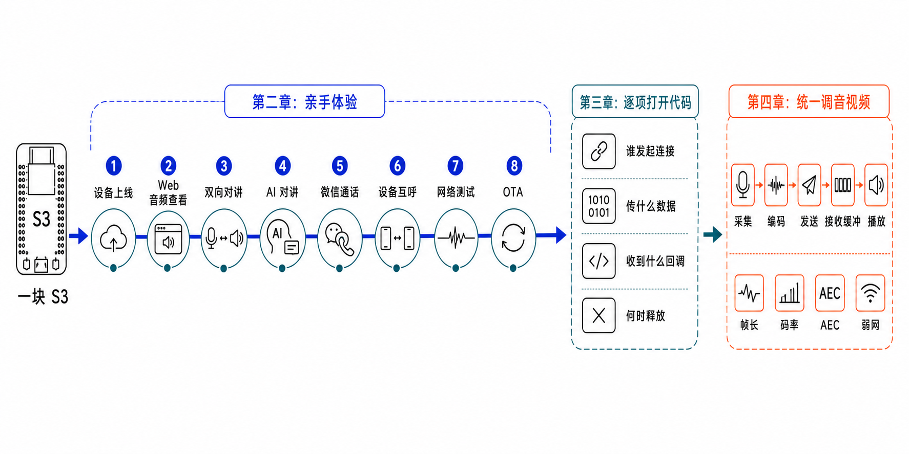

# 小钛君正文档

从 [G32S10X 最小集成](../g32s10x/sdk-integration-examples/README.md)了解 SDK 接入，从 [Device Monitor](../g32s10x/complete-applications/device-monitor/README.md)进入完整应用。本仓尚未提供 G32S10X 最小系统源码，也没有对应的最小系统 Release。

## TiRTC 开发者指南

四章保留共同的概念与调试方法，便于对照平台实现阅读。

| 章节 | 阅读重点 |
| --- | --- |
| [第一章：WebRTC 是什么](01_WEBRTC_OVERVIEW_CN.md) | 连接、时限、传输与跨平台适配 |
| [第二章：TiRTC 的设计与快速体验](02_TIRTC_OVERVIEW_AND_EXPERIENCE_CN.md) | 设备身份、授权与体验流程 |
| [第三章：具体代码实现](03_TIRTC_DEVELOPMENT_CN.md) | 生命周期、异步回调、连接句柄与业务接入 |
| [第四章：音视频调试](04_AUDIO_VIDEO_PIPELINE_CN.md) | 采集、缓冲、编解码和第一处异常的证据链 |

第三、四章主要使用 ESP32-S3/P4 公开实现作例子，芯片专属代码和板卡细节链接到[小钛 ESP32 仓](https://github.com/tangeai/xiaotai-esp32)。这些案例用于理解方法，不证明 G32S10X 具有同样的媒体配置或真机表现。君正实际调用与构建方式以本仓工程为准。

## 按任务选择

| 任务 | 入口 |
| --- | --- |
| 理解联网与 TiRTC 最小调用 | [G32S10X 最小集成](../g32s10x/sdk-integration-examples/README.md) |
| 准备供应商 SDK 和工具链 | [SDK 要求](../g32s10x/sdk-integration-examples/SDK_REQUIREMENTS.md) |
| 接入供应商工程 | [SDK 集成说明](../g32s10x/sdk-integration-examples/SDK_INTEGRATION.md) |
| 开发完整设备应用 | [G32S10X Device Monitor](../g32s10x/complete-applications/device-monitor/README.md) |
| 下载固件、校验或只检出一个项目 | [下载与源码获取](RELEASES_CN.md) |
| 查找 S3/P4 最小系统协议例子 | [小钛 ESP32 文档](https://github.com/tangeai/xiaotai-esp32/blob/main/docs/README_CN.md) |
| 核对原始 Tag、源码与固件 | [迁移说明](MIGRATION_CN.md) / [版本与证据](VERSIONS_CN.md) |

G32S10X 使用君正 Cloner 与目标板 policy。完整应用的主固件、文件系统和 data 镜像需要来自同一 Release；供应商 SDK、交叉工具链和烧录工具从授权渠道获取。

## 协议与证据

设备端与 [tirtc-server-example](https://github.com/tangeai/tirtc-server-example) 使用同一套 ThingConnect 契约，业务字段与服务端行为以其文档为准。

本次迁移只调整目录与文档入口，固件沿用原版本字节。静态来源、原始构建、附件校验、烧录、网络、真实媒体与稳定性分别记录，迁移不补出原来没有的验证。

- [历史变更](CHANGELOG_CN.md)
- [第三方组件与 SDK](THIRD_PARTY_NOTICES_CN.md)
